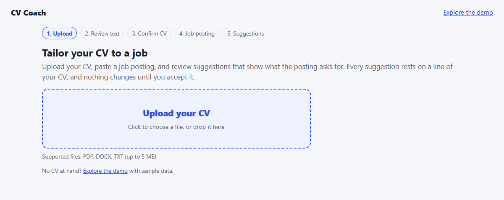
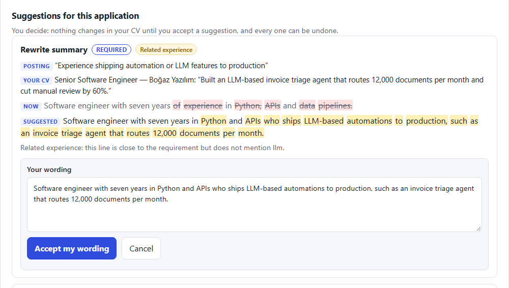
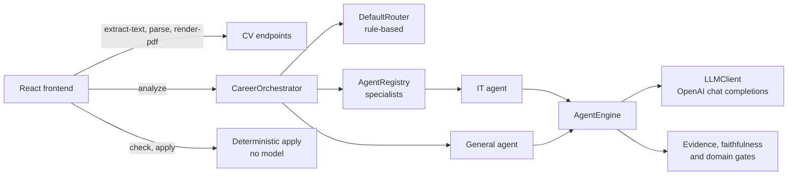

# CV Coach

CV Coach helps a candidate present an existing CV for one job posting. A language model proposes what to
move up, reword or ask about; code then checks every proposal against the posting and the CV, drops the ones
that add facts the CV does not support, and leaves the final decision to the user.

It is a FastAPI backend with a React frontend. Most of the logic is in the backend: how the model's output is
constrained, checked and kept under the user's control.



## What it does

1. Upload a CV (PDF, DOCX or TXT). The text is extracted on the server, shown for review, then structured
   by one model call. The user reviews and confirms the structured CV.
2. Paste a job posting (optionally a career goal, a company name, or a chosen agent).
3. The system picks an agent and returns suggestions: move a line up, reword a line, rewrite the summary,
   plus questions about requirements the CV does not mention.
4. Each suggestion shows the posting line, the CV lines it rests on, and why.
5. The user accepts, edits or rejects each one. A preview shows exactly what the PDF will contain, and the
   PDF is rendered on the server.





The screenshots use the built-in demo with synthetic data.

## How it works



| Component | Responsibility |
|---|---|
| `CareerOrchestrator` | Routes a case, runs one agent, records who answered, and falls back to the general agent. It does no analysis itself. |
| `DefaultRouter` | Chooses an agent by rules (see below). |
| `AgentRegistry` | Holds the specialist agents. Adding one is a registry entry plus its own profile; the orchestrator, router and engine do not change. |
| `CareerAgent` | One implementation: an `AgentCard` plus a `DomainProfile`. The IT agent and the general agent are two instances. |
| `DomainProfile` | What differs per field: system prompt, the model input, validation gates, claim word lists, limits. |
| `AgentEngine` | Stateless execution shared by every agent: prepare the input, call the model, apply the gates, build the result. |
| `LLMClient` | The model call: chat messages, JSON parsing, schema validation, provider errors, call log. |

More detail on one request through these components: [docs/architecture.md](docs/architecture.md).

### Routing and agents

- **Rule-based routing, no model.** Each specialist's card lists a few phrases. If exactly one specialist's
  phrases appear in the job title or the career goal, it is chosen; the posting text can only veto that
  choice. The CV is never read for routing. A `domain` field in the request overrides the rules.
- **Fallback.** If no specialist clearly matches, the general agent analyses the posting. If a specialist
  fails for a reason other than the model (a bug), the general agent answers instead. Model errors are not
  retried with another agent; they reach the client as 504, 503 or 502.
- **Domain-specific agents.** The IT agent and the general agent have different prompts, different model
  inputs and different gates. For example, the IT agent refuses a summary that claims "designed REST APIs" when no CV
  line says something of that kind was designed; the general agent refuses licences, certifications or
  degrees the CV does not list. The general agent also receives degree and certificate names, with school,
  issuer, dates and numbers removed.

### Keeping the model in check

- **Structured output.** The model is asked for JSON (`response_format: json_object`) and the answer is
  validated against a Pydantic schema. An unusable answer becomes an error, not a partial result.
- **Evidence grounding.** Every requirement and suggestion carries a quote that must appear in the posting,
  and cites CV lines by id; ids that do not exist are dropped. The CV lines shown next to a suggestion are
  copied from the CV by code. Newly worded text is the only model-written content, and it is checked. The
  model's claim that a line "directly" matches a requirement is verified by code and downgraded to "related"
  when the line does not contain the requirement's distinctive terms.
- **Validation.** A draft text may not add numbers, seniority words, or posting skills the CV does not
  contain. Proposals that fail any gate are removed, and the response says how many and why (`dropped`,
  `dropped_reasons`); the UI shows this.
- **Human in the loop.** Nothing changes until the user accepts it. An edited text that makes a new claim
  needs an explicit confirmation. Applying decisions, checking text and rendering the PDF are deterministic
  endpoints that never call a model, and the confirmed CV itself is never modified.
- **Data minimization.** The model input is built from a fixed set of fields. Name, contact details, links
  and dates are not sent with an analysis. The CV text sent for structuring is the text the user reviewed.
- **Logging.** Logs carry event names, counts and reason codes. Values that are not short identifiers are
  redacted; CV and posting text are not logged.

Model calls: one per CV structuring, and one per analysis (one more if a posting offers several tracks and
the user picks one, or if the model invents a choice the posting does not offer).

## Tech stack

Python 3.11, FastAPI, Pydantic, OpenAI SDK (chat completions), pypdf, python-docx, fpdf2 (PDF with the
embedded DejaVu font, so Turkish characters work). React 19, TypeScript, Vite. pytest, Vitest and Testing
Library, Ruff.

## Setup

Requirements: Python 3.11+, Node 20.19+ or 22.12+.

```powershell
python -m venv .venv
.venv\Scripts\activate            # macOS/Linux: source .venv/bin/activate
python -m pip install -r requirements-dev.txt
copy .env.example .env            # macOS/Linux: cp .env.example .env
python -m uvicorn app.main:app --reload
```

```powershell
cd frontend
npm ci
npm run dev                       # http://localhost:5173, proxies /v1 to 127.0.0.1:8000
```

Use `python -m uvicorn` rather than `uvicorn`: on Windows the `Scripts` folder is often not on `PATH`.

### Environment variables

| Variable | Default | Purpose |
|---|---|---|
| `OPENAI_API_KEY` | none | Needed for CV structuring and analysis. Without it the API starts and those endpoints answer 503. |
| `OPENAI_MODEL` | `gpt-4.1-mini` | Chat model name. |
| `LOG_LEVEL` | `INFO` | Log level of the `app.*` loggers. |

The key is read at startup; restart the server after editing `.env`. `.env` is git-ignored.

## Demo

Open `http://localhost:5173/demo`. It shows two pre-recorded analyses (an IT posting and a nursing posting)
for synthetic candidates. **No language model is called for the demo, and no API key is needed.** Accepting
suggestions and downloading the PDF use the real API, so the backend must be running.

## API

| Endpoint | Purpose | Model call |
|---|---|---|
| `GET /health` | Liveness | no |
| `POST /v1/cv/extract-text` | Text of an uploaded PDF, DOCX or TXT (multipart, up to 5 MB) | no |
| `POST /v1/cv/parse` | Structure CV text into a CV with stable ids | yes |
| `POST /v1/cv/render-pdf` | Render a CV as a PDF | no |
| `POST /v1/coach/analyze` | Route, analyse a posting, return suggestions, questions and `meta` | yes |
| `POST /v1/coach/check` | What a user-written text claims that the CV does not | no |
| `POST /v1/coach/apply` | The CV with the accepted decisions applied | no |

`analyze` takes `cv`, `job_title`, `job_description` (up to 20,000 characters) and optionally `focus`,
`domain` and `career_goal`. Its response adds `meta`: the routing decision (`primary`, `method`,
`confidence`, `reasons`), the agent runs, and which agent produced each item. Errors: `422` with
`unknown_domain` for an unknown `domain`, `503` without an API key, `504`, `503` or `502` for model failures, `500` if no agent could answer,
`413`, `415` or `422` for uploads that are too large, of an unsupported type or unreadable.

## Tests, lint and build

```powershell
python -m pytest                  # no API key, no network
python -m ruff check .
python -m ruff format --check .

cd frontend
npm test
npx tsc --noEmit
npm run build
```

CI runs the same commands (`.github/workflows/ci.yml`) without any API key. The backend tests use fake
model clients. `tests/golden/coach_regression.json` pins the IT agent's prompt, model input, number of calls
and validation results; regenerate it only for an intended change with
`python -m tests.test_coach_regression --write`.

## Evaluation script

`scripts/run_coach_eval.py` runs the IT agent against the real model on synthetic data (four scenarios) and
prints rule-based checks, for example that no skill from another track is added to the text.

```powershell
python -m scripts.run_coach_eval          # prints the plan, calls nothing
python -m scripts.run_coach_eval --run    # paid model calls, capped by --budget (default 8)
```

The checks cover what rules can decide; read the printed suggestions to judge their quality. No results are
published here.

## Known limitations

- Two agents only (IT and general). Routing matches phrases in the job title or career goal, mostly English;
  an unfamiliar title goes to the general agent.
- Validation is rule-based (word lists, patterns). It reduces unsupported claims but does not prove their
  absence. The seniority and claim word lists cover English and Turkish.
- Scanned PDFs are not supported (no OCR).
- Skill detection in the claim check is heuristic: a skill is recognised when it is capitalised mid-sentence, written
  as a name (CamelCase, ALLCAPS, digits) or followed by "experience" or "knowledge". A plain lowercase or
  sentence-initial word can be missed, and free text that names no skill ("I keep clear written records") is not
  checked.
- The model may ask no questions about requirements the CV lacks (seen in one real run: Pinecone and Kubernetes
  were not raised). Suggestions can also be few when a posting mostly asks for what the CV does not show.
- Text extracted from some PDFs keeps doubled spaces.
- Real-model behaviour was checked once with `gpt-4.1-mini` on two synthetic cases (an IT and a teaching posting);
  this is not a benchmark.
- The CV text and the posting are sent to OpenAI. Review the text before the structuring call.
- Quality was checked with fake clients in tests and a small rule-based script; there are no published
  quality or cost figures, and other models were not tried.
- The frontend keeps its state in memory only; a reload starts over.

## Security scope

This is a local development project, not a hardened service.

- No authentication and no rate limiting. Any client that can reach the API can trigger model calls.
- CORS allows only `http://localhost:5173` and `http://127.0.0.1:5173`.
- Uploads: PDF, DOCX or TXT by extension, at most 5 MB, parsed in memory with pypdf and python-docx. There is
  no content sniffing, no parsing timeout, and no body-size limit at the server level. `cv_text` and the CV
  JSON in several endpoints have no maximum length.
- Nothing is stored on the server. Logs do not contain CV or posting text.
- Dependencies are pinned or locked (`requirements.txt`, `frontend/package-lock.json`). `pip-audit` and
  `npm audit` (with and without dev dependencies) reported no known advisories when last run, on 27 November
  2026. New advisories appear over time; run them again before deploying.
- CV and posting text is passed to a language model, so a crafted document can try to steer it. Its output
  is validated as described above, but this is not a complete defence.

## Repository layout

```
app/
  api/          routes and shared dependencies
  careers/      orchestrator, router, registry, engine and the IT and general agents
  models/       request, response and CV models
  prompts/      prompt for structuring a CV (agent prompts live with their agent)
  services/     LLM client, CV extraction, parsing, PDF rendering, applying decisions
frontend/       React app
scripts/        the evaluation script
tests/          backend tests, fixtures and the golden regression file
docs/           architecture notes and README images
```

## License

MIT, see [LICENSE](LICENSE). The bundled DejaVu fonts have their own license in `app/assets/fonts/LICENSE`.
