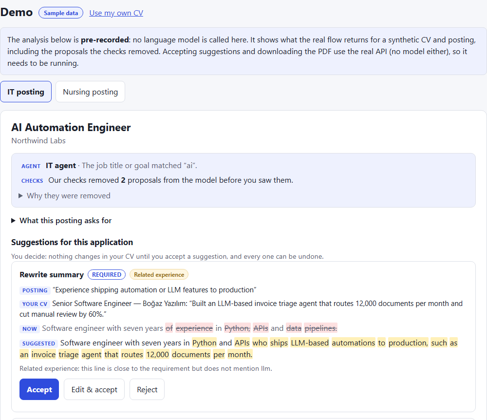
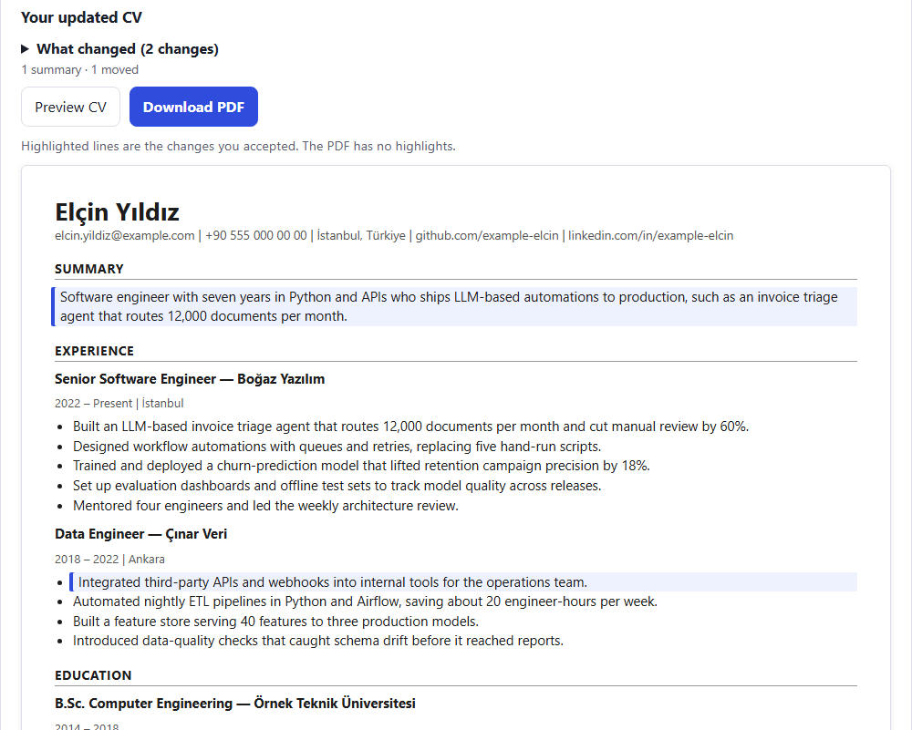
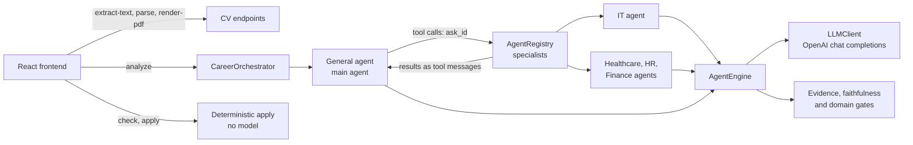

# CV Coach

CV Coach helps a candidate present an existing CV for one job posting. A language model proposes what to
move up, reword or ask about; code then checks every proposal against the posting and the CV, drops the ones
that add facts the CV does not support, and leaves the final decision to the user.

It is a FastAPI backend with a React frontend. Most of the logic is in the backend: how the model's output is
constrained, checked and kept under the user's control.

## Features

- Upload a CV (PDF, DOCX or TXT). The text is extracted and shown for review, then structured by one model
  call. The user confirms the structured CV.
- Paste a job posting (optionally a career goal or a chosen agent). The system picks an agent and returns
  suggestions (move a line up, reword a line, rewrite the summary) plus questions about requirements the CV
  does not mention.
- Each suggestion shows the posting line, the CV lines it rests on, and why.
- The user accepts, edits or rejects each one. A preview shows exactly what the PDF will contain, and the PDF
  is rendered on the server.





## Architecture



- The **General agent** is the main agent: with model tool calling it calls specialists (one `ask_<id>` tool
  each) and answers itself when it calls none. `CareerOrchestrator` is plain code that runs its loop and
  budgets and records who answered. `AgentRegistry` holds the specialists.
- `CareerAgent` is an `AgentCard` plus a `DomainProfile` (prompt, model input, gates, word lists). The IT,
  Healthcare, HR, Finance and general agents are instances; a new specialist is a registry entry plus its profile.
- `AgentEngine` is stateless and shared: prepare the input, call the model, apply the gates, build the result.

More detail: [docs/architecture.md](docs/architecture.md).

## Agents and validation

- **Hierarchical delegation.** In a bounded loop the General agent (which sees the title, career goal and
  posting, never the CV) calls a specialist, reads a summary of its result as the tool message, and may call
  a second one (at most two, each once) or stop. One result is returned unchanged; two are merged by code
  with no model writing, and every item is checked again with its producer's gates. A `domain` in the request
  skips the loop. Model errors are not retried with another agent; a specialist bug is answered by the
  General agent. Each request is limited to 8 model calls, refused before they are made.
- **Domain-specific agents.** Different prompts, model inputs and gates. Examples: the IT agent refuses "designed
  REST APIs" without a CV line; Healthcare refuses clinical acts such as "prescribed"; HR refuses sensitive
  processes such as disciplinary cases; Finance refuses audit or portfolio work; all refuse licences or
  degrees the CV does not list.
- **Evidence grounding.** Every suggestion carries a quote that must appear in the posting and cites CV lines
  by id; unknown ids are dropped. The CV lines shown next to a suggestion are copied by code, and a "direct"
  match claimed by the model is downgraded to "related" when the line lacks the requirement's key terms.
- **Structured output and faithfulness.** The model answers in JSON checked against a Pydantic schema (an unusable
  answer is an error). A draft may not add numbers, seniority words or posting skills the CV lacks; proposals
  that fail a gate are removed and the response says how many and why.
- **Human in the loop.** Nothing changes until the user accepts it. An edited text that makes a new claim
  needs an explicit confirmation. Applying decisions, checking text and rendering the PDF never call a model.
- **Privacy.** The model input is a fixed set of fields without name, contact details, links or dates. Logs
  contain event names, counts and reason codes, not CV or posting text.

## Tech stack

Python 3.11, FastAPI, Pydantic, OpenAI SDK (chat completions), pypdf, python-docx, fpdf2. React 19, TypeScript,
Vite. pytest, Vitest, Ruff, GitHub Actions.

## Setup and demo

Requirements: Python 3.11+, Node 20.19+ or 22.12+.

```powershell
python -m venv .venv
.venv\Scripts\activate            # macOS/Linux: source .venv/bin/activate
python -m pip install -r requirements-dev.txt
copy .env.example .env            # macOS/Linux: cp .env.example .env
python -m uvicorn app.main:app --reload
```

```powershell
cd frontend
npm ci
npm run dev                       # http://localhost:5173, proxies /v1 to 127.0.0.1:8000
```

Set `OPENAI_API_KEY` in `.env` (`OPENAI_MODEL` defaults to `gpt-4.1-mini`) and restart the server. Without a
key the API starts, but CV structuring and analysis answer 503.

**Demo:** open `http://localhost:5173/demo`. It shows two pre-recorded analyses for synthetic candidates. No
model is called and no API key is needed; accepting suggestions and downloading the PDF use the real API, so
the backend must be running.

## Tests

```powershell
python -m pytest                  # no API key, no network
python -m ruff check .

cd frontend
npm test
npx tsc --noEmit
npm run build
```

CI runs the same commands without an API key. Backend tests use fake model clients, and
`tests/golden/coach_regression.json` pins the IT agent's prompt, model input and validation results.

## Known limitations

- Four specialists (IT, Healthcare, HR, Finance) and the General agent. Delegation is decided by the model, so it
  can vary between runs, and a request costs two to eight model calls (about $0.003 with `gpt-4.1-mini`).
- Validation is rule-based. It reduces unsupported claims but does not prove their absence; skill detection is
  heuristic, free text that names no skill is not checked, and a rewrite can add a small unsupported purpose
  phrase. The model may skip questions about requirements the CV lacks. Real-model behaviour was checked once
  per field on synthetic cases, not benchmarked.
- No OCR (scanned PDFs are not supported). CV and posting text are sent to OpenAI.
- Local development project: no authentication, no rate limiting, and the frontend keeps state in memory only.
  Run `pip-audit` and `npm audit` again before deploying.

## License

MIT, see [LICENSE](LICENSE). The bundled DejaVu fonts have their own license in `app/assets/fonts/LICENSE`.
